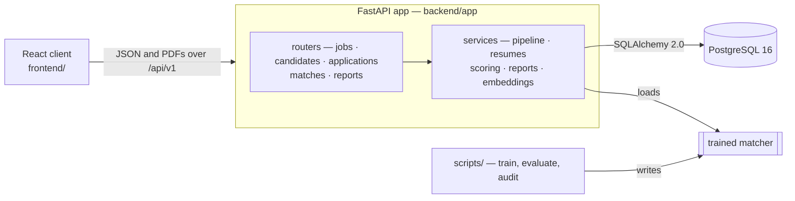
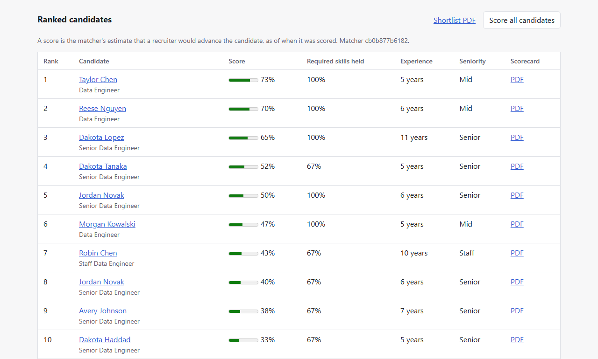
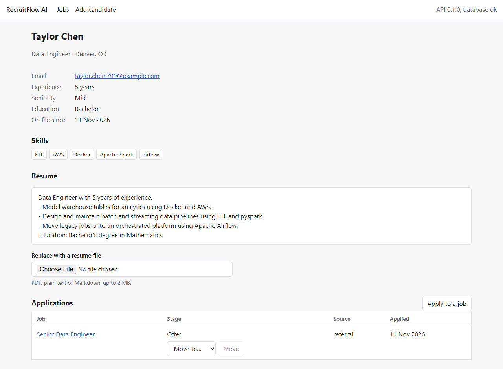
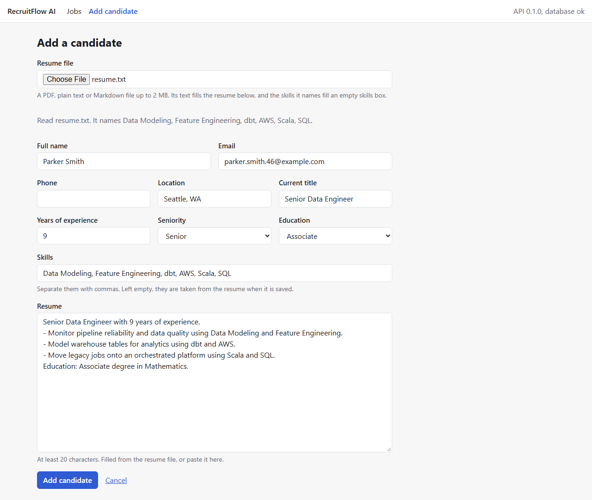

# RecruitFlow AI

A full-stack recruiting platform: a FastAPI and PostgreSQL backend, a React
client, and a scikit-learn matcher that ranks every candidate on file for a
job and explains each score.

Recruiters post jobs, add candidates from resume files, apply them to jobs
and move each application through a hiring pipeline whose every step is
recorded. For any job the matcher scores the whole pool, caches the ranking
with the eight features behind each score, and turns it into a shortlist PDF
and per-candidate scorecards.

**The data is synthetic.** Every job, candidate, resume and past hiring
decision the matcher learns from or is measured on comes from a seeded
generator in this repository, which also plants a bias against women in the
past decisions so that the fairness audit has something real to find. The
figures below say how the code behaves on that corpus, not how it would do on
real applicants.

## Results

Measured on the default corpus (seed 42: 200 jobs, 4,000 candidates, 10,000
labelled pairs) by the committed code. Each link gives the method, the
intervals and what the figure cannot show.

| | Measured | |
| --- | --- | --- |
| Ranking, 50 held-out jobs | NDCG@10 **0.8110** (95% CI 0.7754–0.8444), P@5 **0.7960**; random ranking 0.1638, required-skill coverage alone 0.6533 | [method](docs/guide.md#ranking-quality-on-held-out-jobs) |
| Over ten train/test splits | NDCG@10 0.8102 ± 0.0198, P@5 0.8084 ± 0.0199 | same |
| Retrieval without training | NDCG@10 over all 200 jobs: BM25 0.5333, dense embeddings 0.6566, hybrid (RRF) 0.6392 | [method](docs/guide.md#lexical-dense-and-hybrid-retrieval) |
| Cross-encoder re-rank | NDCG@10 falls to 0.5611 and takes 1.6–1.8 s per slate on a laptop CPU, so the API does not use it | [method](docs/guide.md#cross-encoder-re-rank) |
| Fairness, qualified women against men, top 5 | Equal-opportunity gap −0.140 in the past decisions, −0.050 for a matcher trained plainly on them, **−0.011** for the served matcher, whose interval includes zero in all 17 audit runs | [audit](docs/guide.md#fairness-audit) |
| Fairness, what remains | Over-40s shortlisted more often than under-40s (+0.042 at top 5 over 8 fresh runs), mostly through the jobs' minimum years; long minimums are flagged to the recruiter | same |
| Skills read from resumes | Of the listed skills a resume names, 98.1% to 98.2% found (seeds 42, 5 and 7) | [method](docs/guide.md#skills-from-the-resume) |
| Tests | 1,773 backend and 94 client tests; 99.0% of lines and branches covered when last measured in full; end to end in Chromium, Firefox, WebKit and a phone-sized Chromium on every push | [tests](docs/guide.md#tests) |

## How it fits together



- **Matching:** a calibrated logistic regression over TF-IDF and eight
  engineered features (skill coverage, experience, seniority, education). It
  never reads the resume line the planted bias mostly works through, and is
  trained on past decisions reweighed so that gender and the decision are
  independent. Every cached score is keyed by the matcher's version, so a
  retrained matcher never mixes with old rows.
- **Pipeline:** an application moves applied → screening → interview → offer
  → hired, or to rejected or withdrawn; each application lists the moves the
  API will accept, and the client offers only those.
- **Concurrency:** writes that depend on a row hold it to the commit,
  applications carry a version so a raced update is a 409 rather than lost,
  and a scoring run that loses a race is retried.
- **Resumes:** PDF, plain text or Markdown up to 2 MB, normalised for
  matching; an empty skill list is filled from the skills the resume names.

## In the browser

The client on a database holding twelve jobs and fifty candidates from the
synthetic corpus. A job's page ranks the candidates on file, each with its
score, the share of the required skills held and a scorecard PDF (the first
ten of fifty for a Senior Data Engineer job):



A candidate's page has the resume, the skills, and each application with the
stages it can move to next:



Adding a candidate from a resume file: the file's text fills the resume, and
the skills it names fill the skills box before anything is saved.



## Run it

Needs Python 3.11+, Node 22.22+ and PostgreSQL 16.

```bash
python -m venv .venv
.venv/Scripts/activate                           # source .venv/bin/activate on Unix
pip install -c constraints.txt -e ".[dev]"
cp .env.example .env                             # then set the connection strings
alembic upgrade head
python scripts/train_matcher.py                  # a few seconds
cd frontend && npm ci && npm run build && cd ..
uvicorn app.main:app --app-dir backend           # the app at http://localhost:8000
```

`pytest` runs the backend suite against the test database named in `.env`;
`npm test` in `frontend/` runs the client's. The [guide](docs/guide.md#local-development)
has the development server, the end-to-end tests and every option.

## Limits

- **No authentication or user accounts.** Every endpoint is open to whoever
  can reach the API. Run it only where that is acceptable, or behind
  something that authenticates.
- **Synthetic data only.** The matcher has never been trained or measured on
  real applicants.
- **Scoring runs inside the request**, about 2.5 s for 4,000 candidates; there
  is no background queue.
- **An edit does not rescore.** A score is as of when it was made. The client
  says a job's ranking is from before an edit of that job until it is scored
  again; a ranking is not marked when a candidate on it is edited.
- **The client cannot delete** a job or a candidate; that goes through the
  API.

## More

The [full guide](docs/guide.md) covers each part in depth:
[API and its errors](docs/guide.md#api) ·
[hiring pipeline](docs/guide.md#hiring-pipeline) ·
[resume ingestion](docs/guide.md#resume-ingestion) ·
[synthetic corpus](docs/guide.md#synthetic-corpus) ·
[matching features](docs/guide.md#matching-features) ·
[training](docs/guide.md#training-pipeline) ·
[fairness audit](docs/guide.md#fairness-audit) ·
[embeddings](docs/guide.md#embeddings) ·
[scoring](docs/guide.md#scoring-candidates) ·
[PDF reports](docs/guide.md#pdf-reports).
Measured reports: [model evaluation](docs/model_evaluation.md),
[fairness audit](docs/fairness_audit.md),
[embedding storage](docs/embedding_storage.md); sample
[shortlist](docs/samples/shortlist.pdf) and [scorecard](docs/samples/scorecard.pdf).

| Layer | Choice |
| --- | --- |
| API | FastAPI, Pydantic v2, Uvicorn |
| Database | PostgreSQL 16, SQLAlchemy 2.0, Alembic |
| ML | scikit-learn; sentence-transformers for the measured embeddings |
| Reports | ReportLab |
| Client | React 19, React Router 8, Vite 8, TypeScript, typed from the API's OpenAPI schema |
| Tests | pytest, Vitest, Playwright with axe-core |

## License

MIT — see [LICENSE](LICENSE).
